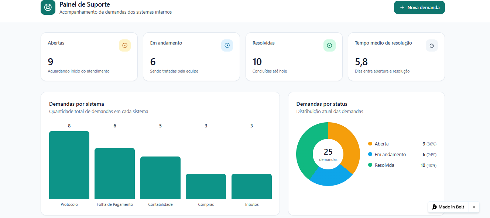
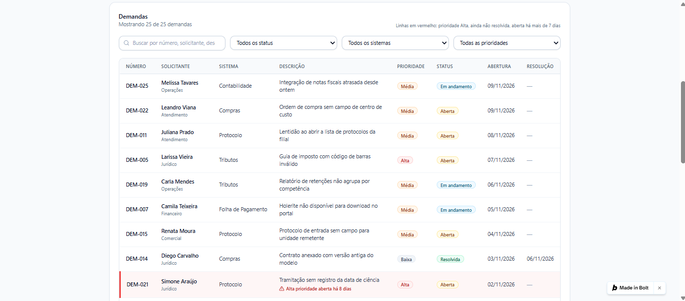
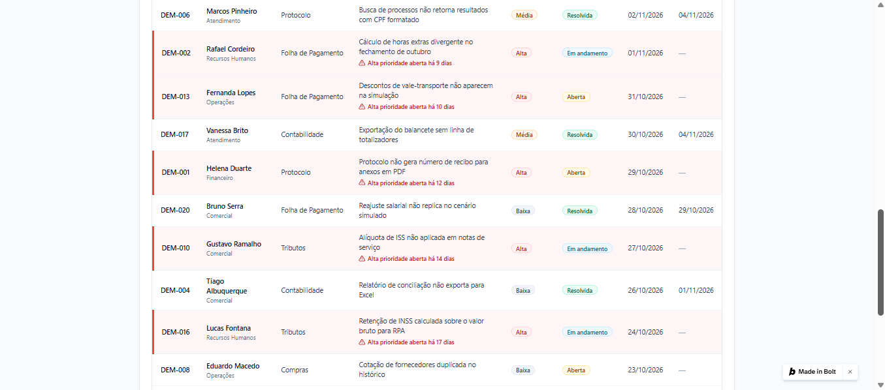

# Painel de Suporte: acompanhamento de demandas

Painel web para acompanhar demandas de suporte de sistemas internos, construído com vibe coding no Bolt.new.

**Demo online:** https://painel-de-suporte-in-nfto.bolt.host

## O problema
Em equipes de suporte, as demandas se espalham entre mensagens e planilhas. Fica difícil saber quantas estão abertas, quais estão paradas e qual sistema dá mais problema.

## A solução
Uma página única que concentra as demandas e mostra o panorama:

- **Cartões:** demandas abertas, em andamento, resolvidas e tempo médio de resolução em dias.
- **Gráficos:** demandas por sistema (barras) e por status (pizza).
- **Tabela** com busca por texto e filtros por status, sistema e prioridade.
- **Formulário** para registrar nova demanda, que atualiza tabela, cartões e gráficos na hora.
- **Alerta visual** para demandas de prioridade Alta abertas há mais de 7 dias.

## Dados
Todos os dados são **fictícios** (25 demandas inventadas, de sistemas genéricos) e ficam na memória do navegador. Não há backend: ao recarregar a página, as demandas voltam ao conjunto inicial.

## Como foi feito
Criado a partir de um pedido detalhado em linguagem natural no Bolt.new, com ajuste e teste manual de cada função (filtros, formulário, cartões, gráficos e alerta). Código em TypeScript, com Vite e Tailwind CSS.

## Limitações e próximos passos
- Salvar as demandas num banco de dados, para os dados não se perderem ao recarregar.
- Usar IA para sugerir categoria e prioridade a partir da descrição da demanda. Esta versão **ainda não usa IA**.
- Autenticação e perfis de usuário.

## Contexto
Projeto de portfólio, feito a partir da minha experiência com suporte e implantação de sistemas.
